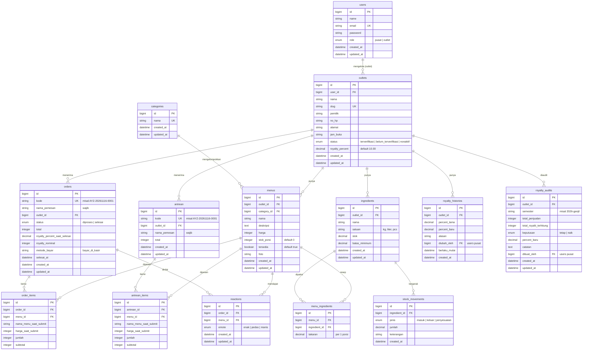

# ERD — Entity Relationship Diagram

## Sistem Informasi Pengelolaan UMKM Lokal Ayiriz

**Pendamping:** `PRD-Ayiriz.md` (apa yang dibangun) dan
`blueprint-Ayiriz.md` (bagaimana membangunnya)
**Database:** MySQL, Laragon lokal, timezone Asia/Makassar
**Status:** Draf v1.1 — fondasi dikunci 2026-11-16; revisi Model B 2026-11-24 (pelanggan tamu, antrean, bayar tunai)

---

## 1. Diagram (Mermaid)

---

## 2. Tabel dan Aturan Penting

### 2.1 `users` — Akun

- `role`: `pusat | outlet`. Satu user satu role. Tidak ada user pelanggan — pelanggan adalah tamu tanpa akun.
- Satu user Outlet mengelola satu outlet (`outlets.user_id`).
  Kalau nanti satu pemilik punya dua kantin, tambah baris outlet
  dengan user berbeda — jangan ubah relasi ini di MVP.
- Password ter-hash (bcrypt). Email unik.

### 2.2 `outlets` — Kantin mitra

- `status`: outlet baru = `belum_terverifikasi`, tidak tampil di
  katalog. Pusat mengubahnya menjadi `terverifikasi` (tampil) atau
  `nonaktif` (disembunyikan).
- `royalty_percent` default `10.00`. Hanya pusat yang boleh
  mengubahnya, dan hanya lewat audit (KF-10) — perubahan langsung
  tanpa audit tidak ada di UI.
- `slug` unik untuk URL `/outlet/{slug}`.

### 2.3 `categories` dan `menus` — Menu

- Kategori bersifat global (misal Makanan Berat, Minuman,
  Cemilan/Dessert), bukan per outlet, supaya filter katalog konsisten.
- `menus.outlet_id` + `menus.category_id`. Harga dalam rupiah
  (integer, tanpa desimal).
- `stok_porsi`: jumlah porsi yang bisa dipesan. Berkurang saat kasir
  mengonfirmasi pembayaran (antrean menjadi pesanan Diproses).
  Antrean tidak mengurangi stok. `tersedia = false` atau
  `stok_porsi = 0` berarti tidak bisa masuk antrean.
- `foto` boleh kosong; tampilkan placeholder kalau kosong.

### 2.4 `orders` dan `order_items` — Pesanan

- `kode` unik, dibuat server saat antrean disubmit (misal
  `AYZ-20261116-0001`); pesanan yang lahir dari antrean itu memakai
  kode yang sama.
- `nama_pemesan` wajib — nama yang ditulis pelanggan tamu saat submit
  keranjang. Tidak ada `user_id` pelanggan; pesanan tidak terikat akun.
- `status` hanya `diproses | selesai` — enum di database, bukan
  string bebas. Transisi hanya Diproses → Selesai. Pesanan dibuat
  langsung berstatus `diproses` saat kasir mengonfirmasi pembayaran.
  Tidak ada status sebelum bayar — sebelum bayar hanya ada antrean
  (lihat §2.8).
- Satu pesanan hanya satu `outlet_id`. Ini ditegakkan di service,
  bukan hanya di keranjang.
- `order_items` mengunci `nama_menu_saat_submit` dan
  `harga_saat_submit` — harga menu boleh berubah sesudahnya tanpa
  mengubah pesanan lama.
- `royalty_percent_saat_selesai` dan `royalty_nominal` diisi saat
  pesanan menjadi Selesai (persen royalti outlet saat itu × total).
  Pesanan Diproses: kedua kolom ini kosong/nol.
- `metode_bayar` selalu `bayar_di_kasir` di MVP.

### 2.5 `ingredients`, `menu_ingredients`, `stock_movements` — Stok

- `ingredients` milik satu outlet (`outlet_id`). Nama bahan boleh
  sama antar outlet — tidak ada bahan global.
- `menu_ingredients` adalah resep sederhana: satu menu memakai
  0..n bahan, masing-masing dengan `takaran` per 1 porsi.
- `stock_movements` adalah jejak perubahan stok bahan: masuk
  (outlet beli/tambah stok), keluar (pemakaian manual), penyesuaian.
  Stok bahan saat ini = jumlah seluruh movement; atau simpan
  `ingredients.stok` sebagai hasil hitung yang diperbarui tiap
  movement — pilih satu, jangan dua-duanya tanpa sinkronisasi.
  Disarankan: `ingredients.stok` diperbarui dalam transaksi yang
  sama dengan penulisan `stock_movements`.
- Pengurangan otomatis dari resep hanya terjadi saat pesanan
  Selesai, dan hanya untuk menu yang punya resep. Pengurangan itu
  juga ditulis sebagai `stock_movements` jenis `keluar` dengan
  keterangan kode pesanan.

### 2.6 `reactions` — Reaksi emote

- `emote`: `enak | pedas | manis` — pemetaan tampilannya:
  `enak = 😋 Enak`, `pedas = 🥵 Pedas`,
  `manis = 🫠 Manis / menyejukkan`.
- **Unique key: `(order_id, menu_id)`.** Satu pesanan hanya punya
  satu reaksi per menu. Reaksi kedua adalah UPDATE, bukan INSERT baru.
- Aturan service (bukan hanya database): reaksi hanya boleh dibuat
  kalau pesanan sudah dibayar — yaitu pesanan sudah ada dengan status
  `diproses` atau `selesai` — dan `menu_id` memang ada di pesanan
  itu. Tidak ada pengecekan akun, karena pelanggan adalah tamu;
  akses halaman reaksi lewat QR pesanan atau kode pesanan.
- **Tidak ada kolom skor, rata-rata, atau ranking.** Hitungan yang
  tampil dihitung langsung: `SELECT emote, COUNT(*) ... GROUP BY
  emote`. Jangan tambahkan kolom agregat ke tabel ini.

### 2.7 `royalty_histories` dan `royalty_audits` — Royalti

- `royalty_histories`: setiap perubahan persen royalti outlet
  dicatat (lama → baru, alasan, siapa yang mengubah, berlaku mulai
  kapan). Ini jejak auditnya.
- `royalty_audits`: satu baris per (outlet, semester) — tambah
  unique key `(outlet_id, semester)`. Berisi snapshot total
  penjualan semester itu, total royalti terhitung, keputusan
  (`tetap | naik`), persen baru, dan catatan pusat.
- Keputusan `naik` di audit harus diikuti baris baru di
  `royalty_histories`; keputusan `tetap` tidak perlu baris baru.

### 2.8 `antrean` dan `antrean_items` — Daftar tunggu

- Antrean adalah keranjang yang sudah disubmit pelanggan tamu, tercatat
  di database agar kasir bisa melihat nama, isi, dan totalnya — tetapi
  **bukan pesanan**: tidak punya kolom status, tidak mengurangi stok
  porsi maupun stok bahan, dan tidak menghitung royalti.
- `kode` dibuat server saat submit; pesanan yang lahir dari antrean
  itu memakai kode yang sama, supaya pelanggan cukup mengingat satu
  kode dari submit sampai ambil.
- `antrean_items` mengunci `nama_menu_saat_submit` dan
  `harga_saat_submit` — harga dikunci saat submit, bukan saat bayar.
- Saat kasir mengonfirmasi pembayaran tunai: sistem membuat `orders`
  + `order_items` dari antrean itu (menyalin nama pemesan, kode,
  total, dan harga yang sudah dikunci), mengurangi `stok_porsi`
  menu, lalu menghapus antrean beserta itemnya — semua dalam satu
  transaksi database. Kalau stok porsi habis di antara submit dan
  bayar, konfirmasi ditolak dan antrean tetap ada.
- Outlet boleh menghapus antrean yang tidak datang; penghapusan itu
  tanpa efek stok maupun royalti.

---

## 3. Indeks yang Perlu Ada

- `orders (outlet_id, status, created_at)` — daftar pesanan outlet
  dan laporan.
- `antrean (outlet_id, created_at)` — daftar tunggu outlet.
- `antrean_items (antrean_id)` dan `(menu_id)`.
- `order_items (order_id)` dan `(menu_id)`.
- `menus (outlet_id, tersedia)` — katalog per outlet.
- `reactions (menu_id, emote)` — hitungan reaksi per menu.
- `reactions` unique `(order_id, menu_id)`.
- `royalty_audits` unique `(outlet_id, semester)`.
- `stock_movements (ingredient_id, created_at)`.

---

## 4. Contoh Data (Seeder, Fiktif)

- 3 outlet contoh: misal "Ayiriz Geprek", "Ayiriz Kopi & Roti",
  "Ayiriz Es & Dessert" — nama contoh, bukan UMKM sungguhan.
- Tiap outlet: 5–8 menu, 2–3 bahan, 1–2 resep sederhana.
- 8–12 pesanan contoh: sebagian Diproses, sebagian Selesai (dengan
  royalti terhitung), masing-masing dengan nama pemesan.
- 1–2 antrean contoh (belum dibayar) supaya daftar tunggu terlihat
  di demo.
- Reaksi contoh tersebar di ketiga emote, supaya hitungan
  `😋 n · 🥵 n · 🫠 n` terlihat di demo — tanpa ada outlet yang
  dibuat "menang".
