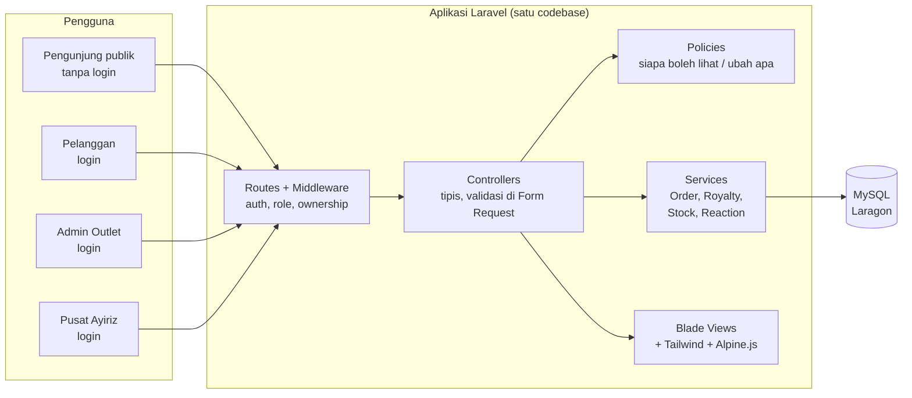

# Blueprint — Gambaran Besar Arsitektur Sistem

## Sistem Informasi Pengelolaan UMKM Lokal Ayiriz

**Nama sistem:** Sistem Informasi Pengelolaan UMKM Lokal Ayiriz
**Brand:** Ayiriz — kantin-kantin mitra di depan gerbang kampus UNG
**Produk:** Website pengelolaan banyak UMKM/kantin F&B dalam satu brand franchise (definisi lengkap di `PRD-Ayiriz.md`)
**Stack yang ditetapkan:** Laravel + Blade + Tailwind CSS + Alpine.js
**Database:** MySQL, Laragon lokal, timezone Asia/Makassar
**Status dokumen:** Draf v1.0, pendamping `PRD-Ayiriz.md`
**Bahasa dokumen:** Bahasa Indonesia

**Cara memakai dokumen ini:** Dokumen ini menjawab *bagaimana* sistem
dibangun dan *bagaimana tiap fitur di PRD bekerja*, dari halaman yang
dilihat pengguna sampai tabel database dan alur di server. Definisi
fungsi, alasan, dan kriteria penerimaannya ada di `PRD-Ayiriz.md`;
pemetaan fitur ke modul, halaman, dan alur di sini ditulis lengkap
supaya pembaca tidak harus membuka PRD untuk memahami gambaran
besarnya. Skema tabel lengkap ada di `ERD-Ayiriz.md`.

> **Batas yang sama dengan PRD, diulang supaya tidak hilang saat
> dokumen ini dibaca terpisah:** Ayiriz adalah **prototipe tugas
> kuliah, bukan franchise sungguhan**. Data seeder adalah contoh
> fiktif. Tidak ada payment gateway nyata, tidak ada kurir/delivery,
> tidak ada gudang pusat. Pembayaran dicatat sebagai "Bayar di Kasir".

---

## 1. Gambaran Besar dalam Satu Gambar

Satu aplikasi web **monolitik Laravel** (bukan SPA, bukan
microservices). Browser meminta halaman, server Laravel memeriksa
login, peran, dan kepemilikan data, mengambil data dari MySQL,
menghitung bila perlu lewat service, lalu me-render Blade.
Interaktivitas ringan (keranjang, filter, modal, tab) ditangani
Alpine.js di browser.



---

## 2. Modul dan Pemetaan Fitur

| Modul | Fitur PRD | Isi |
|---|---|---|
| Auth & Akun | KF-11 | Register/login pelanggan, login pusat & outlet, middleware role, policy kepemilikan |
| Outlet | KF-01 | CRUD + verifikasi outlet oleh pusat, status Aktif/Nonaktif, persen royalti outlet |
| Katalog & Menu | KF-02, KF-03 | CRUD menu per outlet, kategori, pencarian, filter harga/kategori, halaman outlet |
| Pemesanan | KF-04 | Keranjang satu outlet, checkout, kode pesanan, kunci harga saat checkout, kurangi stok porsi |
| Kasir | KF-05 | Daftar pesanan masuk outlet, detail, tandai Selesai, struk sederhana + royalti |
| Stok | KF-06 | Stok porsi menu, stok bahan (masuk/keluar manual), batas minimum, resep sederhana |
| Reaksi | KF-07 | 1 reaksi per menu per pesanan Selesai, ganti reaksi, hitungan per emote (tanpa skor) |
| Laporan | KF-08, KF-09 | Dashboard pusat (gabungan), laporan outlet, filter periode |
| Audit Royalti | KF-10 | Audit per semester per outlet, keputusan Tetap/Naik + alasan, riwayat royalti |

---

## 3. Halaman Utama

### 3.1 Publik (tanpa login)

- `/` — beranda: daftar outlet Aktif, menu populer per outlet (tanpa
  ranking antar outlet), pencarian.
- `/outlet/{slug}` — profil outlet + daftar menunya + hitungan reaksi
  per menu.
- `/menu/{id}` — detail menu + hitungan reaksi (`😋 n · 🥵 n · 🫠 n`).

### 3.2 Pelanggan (login)

- `/keranjang` — keranjang satu outlet, ubah jumlah, checkout.
- `/pesanan-saya` — riwayat pesanan sendiri + status Diproses/Selesai.
- `/pesanan/{kode}` — detail pesanan + tombol beri reaksi (hanya
  kalau Selesai).

### 3.3 Outlet (login)

- `/outlet/dashboard` — pesanan masuk, stok menipis, penjualan hari ini.
- `/outlet/menu` — CRUD menu + kategori + stok porsi.
- `/outlet/pesanan` — daftar pesanan, detail, tombol Selesai.
- `/outlet/stok` — stok bahan, stok masuk/keluar, batas minimum, resep.
- `/outlet/laporan` — laporan outlet sendiri per periode.

### 3.4 Pusat (login)

- `/pusat/dashboard` — total penjualan, per outlet, royalti.
- `/pusat/outlet` — daftar/verifikasi outlet.
- `/pusat/laporan` — laporan gabungan per periode.
- `/pusat/audit` — audit semester per outlet + putuskan royalti baru.

---

## 4. Aturan Inti di Server (Jangan Hanya di Tampilan)

Aturan-aturan ini ditegakkan di model/service/policy, bukan cuma
disembunyikan tombolnya di Blade:

1. **Satu pesanan = satu outlet.** Checkout menolak keranjang yang
   berisi menu dari dua outlet. Validasi di `OrderService`.
2. **Harga dikunci saat checkout.** `order_items` menyimpan
   `harga_saat_checkout` dan `nama_menu_saat_checkout`. Mengubah harga
   menu sesudahnya tidak mengubah pesanan lama.
3. **Status hanya Diproses dan Selesai.** Enum di database dan di
   model hanya berisi dua nilai itu. Transisi yang diizinkan hanya
   Diproses → Selesai, satu arah. Tidak ada status lain di kode.
4. **Kepemilikan outlet.** Policy memastikan outlet hanya bisa
   membaca/mengubah menu, pesanan, stok, dan laporan milik outletnya.
   `outlet_id` di tiap baris dicek di query, bukan hanya di URL.
5. **Royalti hanya dari pesanan Selesai.** `RoyaltyService` menghitung
   royalti dari pesanan Selesai pada periode itu. Pesanan Diproses
   tidak masuk hitungan.
6. **Reaksi hanya untuk pesanan Selesai, satu per menu per pesanan.**
   `ReactionService` menolak reaksi kalau pesanan belum Selesai atau
   bukan milik pelanggan itu. Reaksi kedua menggantikan (update),
   bukan menambah baris. Tidak ada fungsi skor/rata-rata/ranking
   reaksi di codebase — hitungan per emote diambil langsung dengan
   `GROUP BY emote`.
7. **Royalti baru tidak berlaku surut.** Mengubah persen royalti
   outlet hanya mengubah pesanan Selesai sesudah perubahan. Riwayat
   perubahan disimpan di `royalty_histories`; audit semester
   menyimpan snapshot total penjualan dan keputusan.

---

## 5. Alur Fitur (Ringkasan)

### 5.1 Pesan sampai Selesai

```
Pelanggan pilih outlet → tambah menu ke keranjang (satu outlet)
  → checkout → pesanan Diproses, stok porsi berkurang
  → pelanggan datang ke kantin
  → outlet terima bayar di kasir → tandai Selesai
  → royalti 10% tercatat untuk pesanan itu
  → pelanggan boleh beri reaksi emote per menu
  → (kalau menu punya resep) stok bahan berkurang
```

### 5.2 Audit royalti semester

```
Pusat buka /pusat/audit → pilih semester + outlet
  → sistem tampilkan total penjualan Selesai + royalti terhitung
  → pusat putuskan: Tetap atau Naik (+ alasan)
  → simpan ke royalty_histories + audit record
  → persen baru berlaku untuk pesanan Selesai semester berikutnya
```

### 5.3 Stok menipis

```
Outlet set batas minimum per bahan
  → stok bahan <= batas minimum → muncul di dashboard outlet
  → outlet catat stok masuk → peringatan hilang
```

---

## 6. Skema Database (Ringkasan — Lengkap di ERD-Ayiriz.md)

Tabel inti: `users`, `outlets`, `menus`, `categories`,
`orders`, `order_items`, `ingredients`, `menu_ingredients`
(resep), `stock_movements`, `reactions`, `royalty_histories`,
`royalty_audits`. Relasi kuncinya: satu outlet punya banyak menu,
pesanan, dan bahan; satu pesanan punya banyak item dan hanya satu
outlet; satu reaksi milik satu pelanggan, satu pesanan, satu menu,
dengan emote `enak | pedas | manis`; satu audit milik satu outlet
dan satu semester.

---

## 7. Teknologi dan Konfigurasi Lokal

- **Tema visual:** ikuti `Minimalism-Ayiriz.md` dan `Motion-Ayiriz.md` — palet Indomie, Lobster untuk judul/brand, Coolvetica Condensed/Coolvetica dengan fallback Oswald + Archivo (file `woff2` Coolvetica belum ada, jangan mengarang file font itu).
- **Laravel** (Blade + Tailwind + Alpine.js), **MySQL** via Laragon.
- `.env` lokal: `DB_HOST=127.0.0.1`, database `ayiriz`,
  username `root`, tanpa password, port `3306` — aman untuk lokal
  saja, jangan dipakai di production dan jangan commit `.env`.
- Timezone `Asia/Makassar`, bahasa aplikasi `id`.
- Foto menu disimpan di `storage/app/public/menu` dan diakses lewat
  `storage:link`; kalau tidak ada foto, tampilkan placeholder.
- Seeder: `DatabaseSeeder` memanggil seeder outlet, menu, pesanan,
  stok, dan reaksi contoh (lihat PRD §6).

---

## 8. Yang Sengaja Tidak Dibangun

Payment gateway, kurir/delivery, gudang pusat, voucher/promo, poin
loyalitas, teks ulasan, bintang, ranking antar outlet berdasarkan
reaksi, dan status pesanan selain Diproses/Selesai. Kalau salah satu
dari ini muncul di kode "buat jaga-jaga", hapus — menambahnya nanti
lebih murah daripada menjelaskan ke dosen kenapa ada fitur yang
tidak sesuai PRD.
